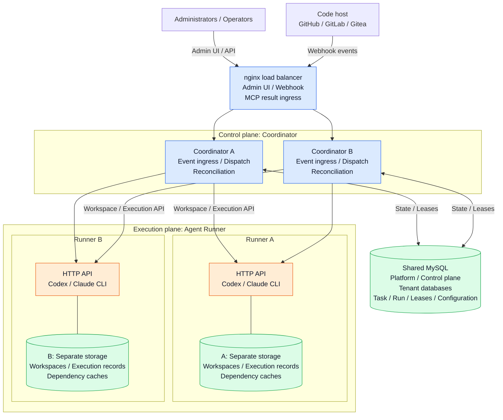
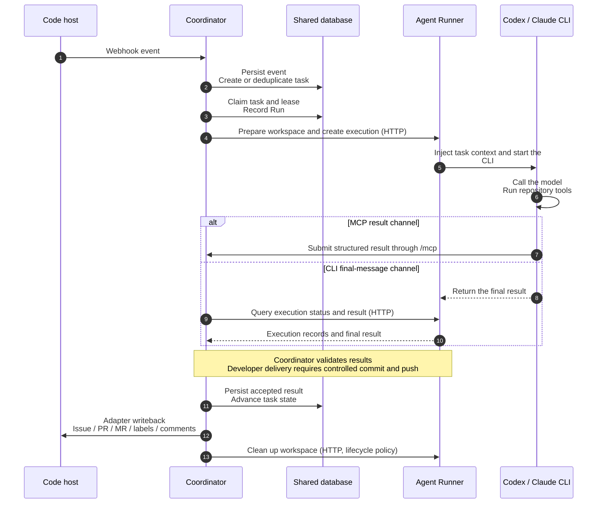

# sdlc-coordinator

English | [简体中文](./README.md)

Control plane for the software development life cycle (SDLC).

It assigns coding agents to repository work, keeps the official task/run state, and writes results back to your code host. The Coordinator is not an agent runtime; the Agent Runner is the separate execution plane.

## Capabilities

- Discover, claim, deduplicate, lease, retry, and recover repository work items.
- Recover `blocked` tasks through safety-gated, generation-scoped, audited rounds; see [blocked task recovery](./docs/blocked-task-recovery.zh-CN.md).
- Persist code-host events and artifacts as structured records.
- Start execution through Agent Runner, inject context, reconcile results, and support recovery.
- Provide an embedded admin UI for run visibility and governance configuration.

## Stack

- Go + Gin + Gorm + Zap
- SQLite (`github.com/glebarez/sqlite`)
- Admin UI: React 18 + TypeScript + Vite + Ant Design (`web/`)

## Layout

- `cmd/coordinator` — control plane
- `cmd/agent-runner` — execution plane
- `web/` — admin console, embedded into the coordinator binary
- `docs/` — public architecture notes and deployment integration guides
- `.local/` — working notes and local secrets; gitignored

## Architecture

This topology follows the [multi-instance deployment example](./deploy/multi-instance/README.md). Two Coordinators share MySQL and call two independent Agent Runners. The root `docker-compose.yml` uses one Coordinator, SQLite, and one Runner.

### Deployment topology

The topology shows ingress, dispatch, and storage connections. The sequence diagram below shows result submission and code-host writebacks.



- **The Coordinator keeps authoritative state**: Each instance runs dispatch logic for TesterWorker, DeveloperWorker, and ReviewerWorker. Instances acquire execution rights through database leases. They also retry tasks, recover runs, and validate results.
- **The Runner executes tasks**: The Coordinator selects an endpoint from the tenant's Runner pool and calls its HTTP API directly. The Runner starts a CLI. The CLI calls the configured model service and runs tests, coding tasks, or reviews in the workspace.
- **Each Runner has separate storage**: Each Runner uses its own workspace, execution-record, and cache storage. Tasks on the same Runner can reuse dependency caches. The Coordinator manages workspaces through HTTP.
- **The Coordinator controls external writes**: Code-host adapters write back Issues, PRs/MRs, labels, and comments. The Coordinator commits and pushes Developer changes through the Runner's controlled workspace API.

### Task execution and result submission

The Coordinator participant represents the instance responsible for the current step. The Runner participant represents the endpoint selected for this run. Webhook and MCP requests pass through the load balancer in the multi-instance deployment. Both result channels use the same validation and idempotent acceptance logic.



Additional deployment documentation:

- [GitHub Repository Integration (English)](./docs/github-repository-integration.en.md)
- [GitHub 仓库集成（中文）](./docs/github-repository-integration.zh-CN.md)
- [Gitea Repository Integration (English)](./docs/gitea-repository-integration.en.md)
- [Gitea 仓库集成（中文）](./docs/gitea-repository-integration.zh-CN.md)
- [Multi-instance deployment](./deploy/multi-instance/README.md)
- [Agent Runner runtime directory](./deploy/agent-runner-runtime/README.md)

## Run

Build the coordinator image with `build.sh`. Compose expects an external Docker network:

```bash
docker network create sdlc-net
```

Then start from `docker-compose.yml`. The Agent Runner image uses Alpine 3.24 with Go 1.25, JDK 8/17/21, Node.js 24, npm, pnpm 11, Maven 3.9, Python and pip. JDK 21 is the default. Codex is required under `deploy/agent-runner-runtime/`; Claude remains optional. Development tools are installed during the image build.

Set `RESULT_CHANNEL_SECRET` to a stable 64-character hex string and `AGENT_RUNNER_INTERNAL_TOKEN` to the same nonempty token on the coordinator and Runner. These deployment credentials are required and are not stored in runtime configuration snapshots. Multiple coordinators must share the result-channel secret.

The coordinator prepares, delivers, and cleans up workspaces through the Runner HTTP API, including on a single host with SQLite. Only the Runner mounts the workspace directory. Its `AGENT_RUNNER_WORKSPACE_ROOT` environment variable selects the root; changing it requires updating the deployment and recreating the Runner container. The admin configuration API and runtime snapshots contain no workspace-root settings.

Each Runner keeps dependency caches under `AGENT_RUNNER_CACHE_ROOT` (default `/app/dependency-cache`). Compose mounts `./dependency-cache` there. Tasks on that Runner share Go module/build caches, npm cache, pnpm store and metadata cache, pip cache and the Maven local repository. Reuse the same mount when replacing the container. Separate Runner instances must use separate cache directories or volumes. Agent HOME remains temporary; project installations such as `node_modules` and Python virtual environments stay in the workspace.

The entrypoint gives the cache root to Agent UID/GID `10002:10002`. Existing contents must be writable by that identity; startup does not recursively change the whole cache. To reclaim cache space, stop that Runner first and clear only its cache storage. The Maven local repository can retain locally installed artifacts. Private dependencies in these caches are also shared within this Runner's trust boundary.

Use `JAVA8_HOME`, `JAVA17_HOME` or `JAVA21_HOME` to select another installed JDK for a command, for example:

```sh
JAVA_HOME="$JAVA8_HOME" PATH="$JAVA8_HOME/bin:$PATH" mvn test
```

Admin UI: `http://<host>:<port>/admin`

The first super admin is seeded from `CONTROL_PLANE_SUPERADMIN_USERNAME` / `CONTROL_PLANE_SUPERADMIN_PASSWORD` environment variables at startup; startup refuses to run without `CONTROL_PLANE_DSN` and these credentials. Do not expose this service to the public internet.

## Tests

```bash
go test ./...
cd web && npm ci && npm test -- --run && npm run typecheck && npm run build
```

GitHub Actions runs the same checks on `main` and pull requests.

The Runner image build also runs `deploy/tests/runner-toolchains.sh` as Agent UID 10002. To check cache reuse with fixed test dependencies, run the following on a Docker host. The test submits execution requests through both Codex and Claude Providers, including the launcher and Agent identity switch. It creates and removes its own containers and volumes, downloads dependencies on the first pass, then replaces the container with networking disabled:

```sh
deploy/tests/runner-cache.sh sdlc-agent-runner:YOUR_TAG
```

Set `TEST_GOPROXY` if the Docker host requires another Go module proxy. Set `TEST_CACHE_ROOT` to verify a custom cache mount; the default is `/app/dependency-cache`. `RUNNER_CACHE_TEST_OUTPUT` selects the evidence directory. The test replaces both model CLIs with fixed scripts and does not call a model.

## License

Apache License 2.0. See [LICENSE](./LICENSE).
