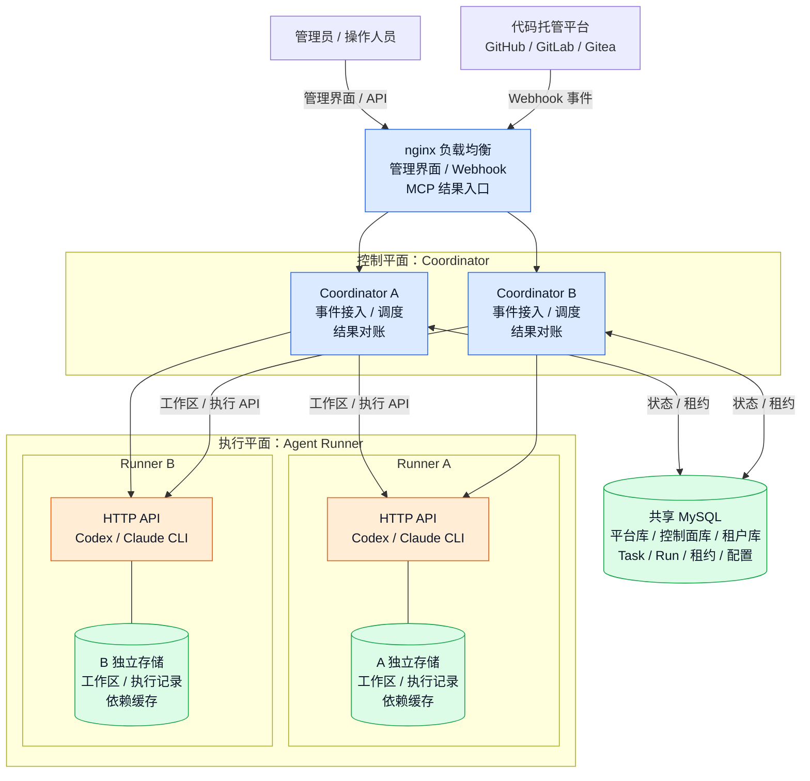
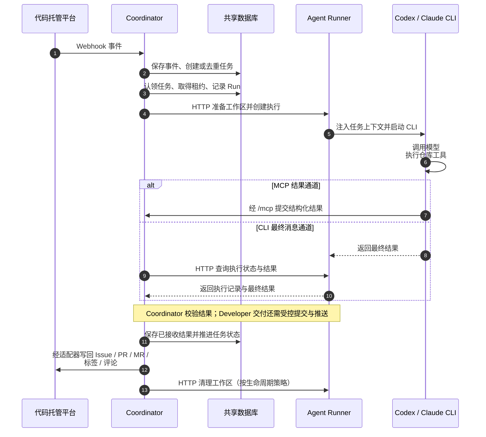

# sdlc-coordinator

[English](./README.en.md) | 简体中文

面向软件开发生命周期（SDLC）的控制平面。它把仓库工作分配给编码代理，保存任务与运行状态的权威记录，并将结果写回代码托管平台。Coordinator 不是 Agent 运行时；Agent Runner 是独立的执行平面。

## 核心能力

- 发现、认领、去重、租约、重试和恢复仓库工作项。
- 将代码托管平台事件与产物保存为结构化记录。
- 通过 Agent Runner 启动执行、注入上下文、对账结果并支持恢复。
- 提供嵌入式管理界面，用于查看运行状态和治理配置。

## 技术栈

- Go + Gin + Gorm + Zap
- SQLite（`github.com/glebarez/sqlite`）
- 管理界面：React 18 + TypeScript + Vite + Ant Design（`web/`）

## 项目结构

- `cmd/coordinator` — 控制平面
- `cmd/agent-runner` — 执行平面
- `web/` — 管理控制台，构建产物嵌入 Coordinator 二进制
- `docs/` — 公共架构说明与部署集成指南
- `.local/` — 工作笔记和本地密钥；已被 Git 忽略

## 架构

以下拓扑对应 [多实例部署样例](./deploy/multi-instance/README.md)：两个 Coordinator 共享 MySQL，并调用两个独立的 Agent Runner。根目录的 `docker-compose.yml` 使用单个 Coordinator、SQLite 和单个 Runner。

### 部署拓扑

拓扑图展示入口、调度和存储关系。结果回传与代码托管平台写回见下方时序图。



- **Coordinator 保存权威状态**：每个实例运行 TesterWorker、DeveloperWorker 和 ReviewerWorker 的调度逻辑。实例通过共享数据库中的租约竞争执行权，并负责重试、恢复和结果校验。
- **Runner 执行任务**：Coordinator 按租户的 Runner 池选择端点并直接调用 HTTP API。Runner 启动 CLI，CLI 调用配置的模型服务并在工作区执行测试、编码或审查。
- **Runner 存储相互隔离**：每个 Runner 使用自己的工作区、执行记录和缓存存储。同一 Runner 内的任务可复用依赖缓存；Coordinator 通过 HTTP 管理工作区。
- **Coordinator 控制外部写入**：Issue、PR/MR、标签和评论由代码托管适配器写回。Developer 的 Git 提交与推送由 Coordinator 通过 Runner 的受控工作区接口完成。

### 一次任务的执行与回传

图中的 Coordinator 表示当前负责该步骤的实例，Runner 表示本次运行选中的端点。Webhook 和 MCP 请求在多实例部署中经过负载均衡；两个结果通道进入同一套校验与幂等接收逻辑。



更多部署资料：

- [GitHub 仓库集成（中文）](./docs/github-repository-integration.zh-CN.md)
- [GitHub Repository Integration (English)](./docs/github-repository-integration.en.md)
- [多实例部署说明](./deploy/multi-instance/README.md)
- [Agent Runner 投放目录](./deploy/agent-runner-runtime/README.md)

## 运行

使用 `build.sh` 构建 Coordinator 镜像。Compose 需要一个已存在的外部 Docker 网络：

```bash
docker network create sdlc-net
```

然后从 `docker-compose.yml` 启动。Agent Runner 镜像基于 Alpine 3.24，包含 Go 1.25、JDK 8/17/21、Node.js 24、npm、pnpm 11、Maven 3.9、Python 和 pip。默认 JDK 是 21。Codex 必须投放到 `deploy/agent-runner-runtime/`；Claude 仍为可选依赖。开发工具链在镜像构建阶段安装。

设置 `RESULT_CHANNEL_SECRET` 为稳定的 64 位十六进制字符串，并在 Coordinator 与 Runner 上设置相同的非空 `AGENT_RUNNER_INTERNAL_TOKEN`。这些部署凭据是必需的，不会保存到运行时配置快照中。多个 Coordinator 必须共享同一个结果通道密钥。

Coordinator 通过 Runner HTTP API 准备、投递和清理工作区；即使使用 SQLite 的单主机部署也采用这一方式。只有 Runner 挂载工作区目录。`AGENT_RUNNER_WORKSPACE_ROOT` 选择工作区根目录；修改它需要同步更新部署并重建 Runner 容器。管理配置 API 和运行时快照不包含工作区根目录设置。

每个 Runner 把依赖缓存保存在 `AGENT_RUNNER_CACHE_ROOT`（默认 `/app/dependency-cache`）。Compose 将 `./dependency-cache` 挂载到该路径。同一 Runner 上的任务共享 Go 模块与构建缓存、npm 缓存、pnpm store 和元数据缓存、pip 缓存以及 Maven 本地仓库。替换容器时，请继续复用同一个挂载。独立的 Runner 实例必须使用各自独立的缓存目录或卷。Agent HOME 仍是临时的；`node_modules`、Python 虚拟环境等项目级安装会保留在工作区内。

entrypoint 会把缓存根目录授予 Agent UID/GID `10002:10002`。现有内容必须可被该身份写入；启动时不会递归修改整个缓存的所有权。如需回收缓存空间，先停止对应 Runner，再只清理其缓存存储。Maven 本地仓库可能保留本地安装的构件。这些缓存中的私有依赖也只应在该 Runner 的信任边界内共享。

使用 `JAVA8_HOME`、`JAVA17_HOME` 或 `JAVA21_HOME` 为命令选择其他已安装的 JDK，例如：

```sh
JAVA_HOME="$JAVA8_HOME" PATH="$JAVA8_HOME/bin:$PATH" mvn test
```

管理界面地址：`http://<host>:<port>/admin`

首个超级管理员在启动时由 `CONTROL_PLANE_SUPERADMIN_USERNAME` 和 `CONTROL_PLANE_SUPERADMIN_PASSWORD` 环境变量创建。启动时缺少 `CONTROL_PLANE_DSN` 或上述凭据会直接失败。请勿将该服务暴露到公共互联网。

## 测试

```bash
go test ./...
cd web && npm ci && npm test -- --run && npm run typecheck && npm run build
```

GitHub Actions 会在 `main` 分支和拉取请求上执行相同的检查。

Runner 镜像构建还会以 Agent UID 10002 运行 `deploy/tests/runner-toolchains.sh`。如需用固定的测试依赖检查缓存复用，请在 Docker 宿主机上执行以下命令。该测试通过 Codex 和 Claude Provider 提交执行请求，覆盖 launcher 和 Agent 身份切换。它会创建并移除自己的容器和卷，首轮下载依赖，随后替换容器并禁用网络：

```sh
deploy/tests/runner-cache.sh sdlc-agent-runner:YOUR_TAG
```

如果 Docker 宿主机需要其他 Go 模块代理，设置 `TEST_GOPROXY`。设置 `TEST_CACHE_ROOT` 可验证自定义缓存挂载；默认值是 `/app/dependency-cache`。`RUNNER_CACHE_TEST_OUTPUT` 选择证据输出目录。测试会用固定脚本替换两个模型 CLI，因此不会调用模型。

## 许可证

Apache License 2.0。详见 [LICENSE](./LICENSE)。
