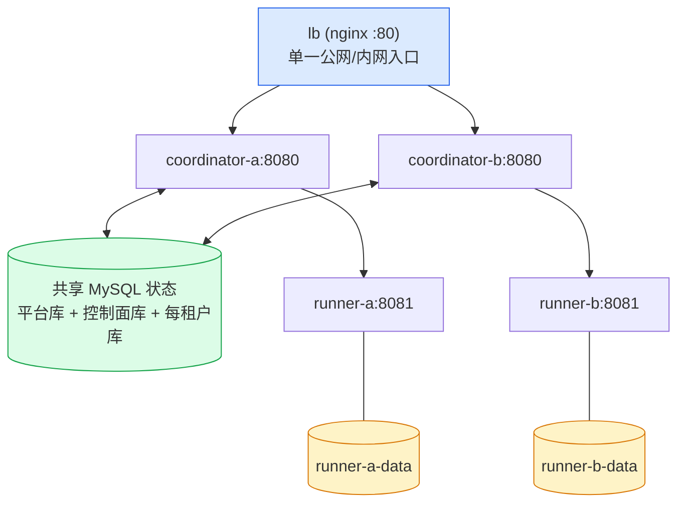

# 多实例隔离部署样例（MySQL + LB + 2 Coordinator + 2 Runner）

测试部署样例：验证"共享 MySQL 状态、双协调器多活、双 Runner 隔离卷"的分布式形态。
单机多容器用于前置验证；跨机部署把 `docker-compose.multi.yml` 拆到两台主机
（各跑一台 Runner + 一个 Coordinator，MySQL 与 LB 独立部署），环境变量注入
地址与凭据，样例内不落真实值。

## 拓扑



- 协调器无共享文件卷：平台库、控制面库、租户库全部在 MySQL（按租户分库）。
- Runner 各自独占命名卷（`runner-a-data` / `runner-b-data`），不挂共享工作区；
  同一租户的池内端点互斥由启动校验保证（同端点指派给多租户拒绝启动）。
- Runner 的授权确认入口指向 LB：任一协调器副本基于共享库裁决当前归属。

## 启动

1. 构建镜像（仓库根）：

   ```sh
   docker build -t sdlc-coordinator:latest .
   docker build -t sdlc-agent-runner:latest -f Dockerfile.agent-runner .
   ```

   runner 镜像要求 codex 工具投放（`deploy/agent-runner-runtime/codex-package/`）；
   测试部署可投放测试替身脚本（见下），生产部署投放官方 codex 包。

2. 注入环境变量（占位值仅供本机联调，部署时替换）：

   ```sh
   export MULTI_SECRET=$(openssl rand -hex 32)        # 部署级共享密钥（hex 64）
   export MULTI_SUPERADMIN_USERNAME=superadmin
   export MULTI_SUPERADMIN_PASSWORD='change-me-1'      # 种子超管密码
   export MULTI_MYSQL_PASSWORD='change-me-2'           # MySQL root 密码
   export MULTI_LB_PORT=8090                           # 宿主机 LB 端口
   ```

   `MULTI_SECRET` 是 RESULT_CHANNEL_SECRET（MCP 回传签名）与
   AGENT_RUNNER_INTERNAL_TOKEN（受控工作区通道）共用的部署级密钥：
   双协调器、双 Runner、LB 之后的全部成员持同一值。缺省时协调器启动即失败。

3. 拉起并验证：

   ```sh
   docker compose -f docker-compose.multi.yml up -d
   curl http://127.0.0.1:8090/healthz      # 经 LB 的健康面
   ```

4. 初始化业务面（超管首登 + 租户开通 + runner 指派）：

   ```sh
   # 超管登录（会话为 http-only cookie）
   curl -c cookies.txt -X POST -H 'Content-Type: application/json' \
        -d '{"username":"superadmin","password":"<MULTI_SUPERADMIN_PASSWORD>"}' \
        http://127.0.0.1:8090/api/portal/auth/login
   
   # 指派 runner 池：租户 N 的任务轮询 runner-a/b 两个端点
   curl -b cookies.txt -X PUT \
        -H 'Content-Type: application/json' \
        -d '{"endpoints":["http://runner-a:8081","http://runner-b:8081"]}' \
        http://127.0.0.1:8090/api/super-admin/tenants/<TENANT_ID>/runner-assignments
   ```

   单租户联调也可以只指派一个端点；未指派租户回退各协调器配置的默认池
   （coordinator-a → runner-a，coordinator-b → runner-b）。

## 测试替身 codex（无模型凭据联调）

`deploy/agent-runner-runtime/codex-package/bin/codex` 提供与真实 CLI 同协议
的测试替身（`--version` / `exec` 事件流 / 最终消息文件）。部署前把该脚本放到
投放目录即可构建 runner 镜像；行为经 Runner 环境变量控制：

| 变量 | 取值 | 行为 |
|---|---|---|
| `FAKE_CODEX_MODE` | `success`（默认）/ `fail` / `slow` | 正常 / turn.failed / 挂起指定秒数 |
| `FAKE_CODEX_VERDICT` | reviewer 判决词 | 写进最终消息的 verdict 字段 |
| `FAKE_CODEX_RESULT_JSON` | 完整 JSON | 覆盖最终消息整体 |

## 故障矩阵

```sh
cd deploy/multi-instance
faultsuite/run.sh                       # 全部场景
faultsuite/run.sh coordinator_pause     # 单场景
```

场景与断言（JSON Lines 落 `faultsuite-results.jsonl`，不依赖人工截图）：

套件会把尚未验证的任务书业务项作为 `not_covered` 写入结果，并在汇总中
单独计数。`smoke_*` 断言只表示进程、容器或连通性正常，不代表在途业务已收敛。

| 场景 | 注入 | 断言要点 |
|---|---|---|
| `coordinator_pause` | `docker pause` 协调器 A 20s | 暂停期间经 B 创建租户；MySQL 中控制面记录与租户库均存在；A 恢复后状态仍在且无异常重启 |
| `coordinator_kill` | `kill -9` 协调器 A | 存活实例全程服务；人工 start A 后恢复 ready |
| `runner_kill` | `kill -9` Runner A | 卷保留重启后健康；另一 Runner 不受影响 |
| `net_block` | 断开 Runner A 容器网络 15s | 协调器存活；恢复后可达 |
| `lb_failover` | `stop` 协调器 B | Portal 会话经 A 仍有效；A 创建租户后 MySQL 中控制面记录与租户库均存在；B 重启回池 |

当前 shell faultsuite 对 A06 原执行复用与副作用次数、A07 陈旧 owner/generation
栅栏、A11 中断结果恢复、A12 不确定执行边界、A18 MySQL 断连/死锁/锁超时均报告
`not_covered`。这些标记只描述本部署故障套件；相关语义另有 Go 自动化测试，CI
的 `go test ./...` 会运行这些测试，其中 A07、A18 需要 CI 提供的 MySQL：

- A06：`TestA06TakeoverReusesExecutionStartedBeforeCoordinatorExit`，使用 fake
  Runner 验证接管复用原执行，不验证实际多容器交付副作用。
- A07：`TestRemoteDeliveryTakeoverFencesStaleCoordinatorOnMySQL`，MySQL 集成测试。
- A11：`TestRestartRecoveredInterruptedExecutionConvergesThroughCoordinator`，以及
  Runner 的重启恢复测试。
- A12：`TestAcceptedExecutionMissingAfterRunnerVolumeLossRemainsUnknown` 和
  `TestAmbiguousCreateAndRunner404DoNotFailOrRotate`。
- A18：`TestA18MySQLDeadlockErrorIsRetryable`、
  `TestA18MySQLDispatchLockTimeoutDoesNotConsumeAttemptAndRetriesNextDispatch`、
  `TestA18MySQLDisconnectDoesNotDispatch`，均为 MySQL 集成测试。

这些 Go 测试不计入 shell faultsuite 覆盖数；结果文件会同时保留对应的
`not_covered` 记录，避免把单元/集成测试误读成部署故障场景通过。

## 扩缩容

- **加 Coordinator**：复制 `coordinator-a` 服务定义改实例名与日志卷（同一
  MySQL、同一 `RESULT_CHANNEL_SECRET`），加入 nginx upstream，reload 即可。
  多实例无主从之分，调度、事件、恢复、限流全部经共享库竞争收敛。
- **加 Runner**：起容器（独立命名卷、`AGENT_RUNNER_INTERNAL_TOKEN` 同值、
  `AGENT_RUNNER_AUTHORIZATION_URL` 指向 LB），然后 `PUT runner-assignments`
  把新端点追加进租户池。池内轮询立刻生效，无需重启协调器。
- **缩容 Runner**：先从租户池移除该端点（不再接新任务），等在途执行收尾
  （或按恢复策略被另一实例接管）后再停容器。
- **缩容 Coordinator**：从 nginx upstream 摘除后 `stop`。注意 LB 探活/摘除
  先于停容器，避免 502 窗口。

本样例按 2 个 Coordinator 计算 MySQL 连接上限：每个进程的平台库、控制面库、
开通库各最多 16 条，全部租户库共享最多 16 条，故两进程最多
`2 × (3 × 16 + 16) = 128` 条。Compose 将 MySQL `max_connections` 设为 200，
给管理连接和其他客户端留出 72 条。扩容 Coordinator 或调高任一非租户池上限前，
先按新副本数重算总量，并同步调整 MySQL 上限及预留量；仅增加副本而不重算容量
可能使新连接被 MySQL 拒绝。

## 停机与 schema 迁移顺序

- **正常停机**：先停 Runner（排空执行），再停 Coordinator，最后停 MySQL。
  Runner 先行是因为在途 CLI 执行只能由其所在 Runner 收尾。
- **schema 迁移**：迁移经 MySQL 全局锁（GET_LOCK）串行化，双协调器同时启动
  只有一个执行迁移、另一个等待；先启动的实例承担迁移。滚动升级顺序：
  1. 停一个协调器 → 替换镜像 → 启动（此时它执行新 schema 迁移）；
  2. 确认健康后，逐台替换其余协调器；
  3. Runner 镜像最后滚动替换（runner 协议随协调器兼容窗口验证）。
  降级（新 schema → 旧代码）不在支持范围：先回滚代码再回滚 schema。
- **MySQL 维护**：短暂重启协调器可自愈（连接池重建）；长维护建议全栈停机。

## 密钥配置

| 密钥 | 注入点 | 说明 |
|---|---|---|
| `MULTI_SECRET`（→ `RESULT_CHANNEL_SECRET`） | 两个协调器 | MCP 回传 token 签名；双实例同值（A 签 B 验），缺省启动失败 |
| `MULTI_SECRET`（→ `AGENT_RUNNER_INTERNAL_TOKEN`） | 两个协调器 + 两个 Runner | 受控工作区通道（/internal/*）与授权确认；全成员同值 |
| `MULTI_SUPERADMIN_PASSWORD` | 两个协调器 | 种子超管；仅在空库首次启动生效 |
| `MULTI_MYSQL_PASSWORD` | MySQL + 全部成员 | 样例简化为 root 单账号；生产应建最小权限业务账号 |

密钥只从环境注入（`.env` 不入库）；轮换 `MULTI_SECRET` 需滚动重启全部成员
（会话 cookie 与在途回传 token 在旧密钥签发窗口内失效，属预期边界）。

## 跨机部署差异

单机样例 → 两台主机的改动点：

1. 每台主机各跑一个 Coordinator + 一个 Runner（compose 只保留本机服务）。
2. MySQL 与 nginx 部署在独立主机或其中一台（`COORDINATOR_DATABASE_DSN`、
   `CONTROL_PLANE_DSN`、`AGENT_RUNNER_SERVICE_URL`、
   `AGENT_RUNNER_AUTHORIZATION_URL` 改为跨机地址）。
3. 唯一的文件系统边界就在两台 Runner 的数据卷——隔离断言在跨机形态下
   才算真正过界；单机多容器只是前置验证。
4. webhook 与 Portal 入口统一走 LB 公网地址；Runner 之间不需要互通。
